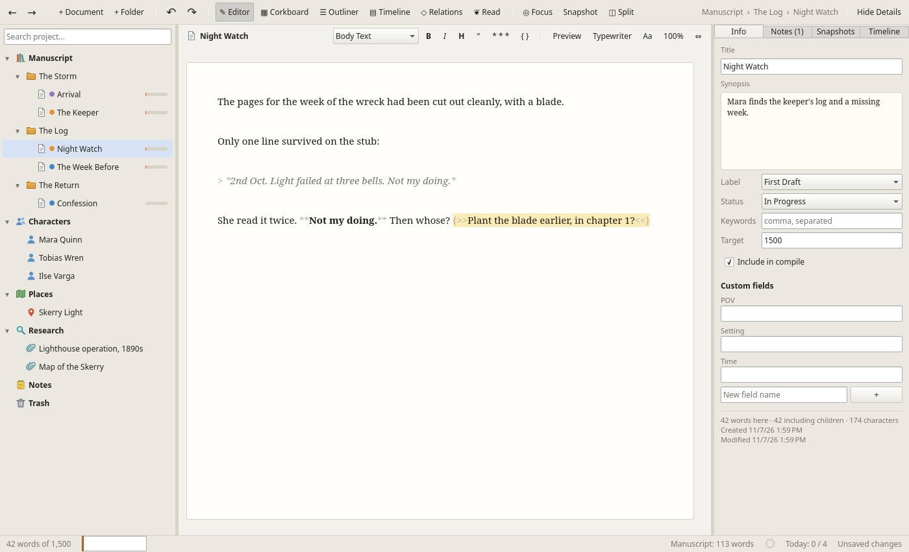

# Wordloom

A writing studio for novels and other long-form work, built in **Rust** with a **Qt 6 / QML** interface.
Wordloom is organised around the same ideas as Scrivener (a binder, index cards, an outliner,
snapshots, compile) without copying it, and adds a **story-timeline Gantt chart** for plotting
characters, events and plotlines in time.

It runs on Linux today. The code is written to build unchanged on Windows and macOS, since Qt and
Rust both support those platforms. CI builds and tests Linux on every push. The Windows installer
(MSI) and macOS disk image (DMG) are built by a separate release workflow, which has not yet been
run (see [Installing on Windows and macOS](#installing-on-windows-and-macos)).



More screenshots: [timeline](docs/screenshots/timeline.png) ·
[relationship map](docs/screenshots/relations.png) · [corkboard](docs/screenshots/corkboard.png) ·
[split editor](docs/screenshots/split.png).

## Features

| Area | What you get |
|---|---|
| **Project templates** | File ▸ New Project… offers a starting shape. **Blank**: one chapter with one scene. **Novel**: Acts I–III with eight chapters, each with a first scene and a synopsis saying what that part of the story does (inciting incident, midpoint, climax…), Protagonist and Antagonist sheets, a Main Setting, and a *Premise* note. **Short Story**: five scenes from Opening to Resolution, without chapters. **Non-fiction**: Front Matter (Introduction), three chapters of sections, Back Matter (Conclusion, Acknowledgements), an *Outline* note and a *Sources* research note. Templates add no text, so word counts start at zero; rename, delete or add anything. |
| **Binder** | A project tree with fixed sections (Manuscript, Characters, Places, Research, Notes, Trash). Drag and drop, inline rename (F2), keyboard moves (Ctrl+↑/↓ to move, Ctrl+←/→ to outdent/indent), duplicate, split at cursor, merge, convert type, trash/empty trash. Clicking a document opens it in the editor; clicking a folder with no text of its own shows its contents on the corkboard. Items with a word target (set in the Details panel) show a small progress bar, green once reached; hover it for the numbers. **Several at once**: Ctrl+click adds or removes items and Shift+click picks a range; right-click one of them to give them all a label or status, include or exclude them from compile, or move them to the Trash (Delete does that too). Drag any of them to move them all, keeping their order. Each is a single undo step. A plain click or Esc goes back to one item. **Icon & Colour**: right-click an item (or several picked ones) ▸ *Icon & Colour…* to give it one of 30 icons (folder, document, book, person, crown, pin, map, globe, dialogue, clock, calendar, star, heart, flag, bookmark, idea, key, sword, question, warning, done and more), colour the icon (a folder in red, say), and colour its title and its row's background. Pick from ten colours or choose any with *Custom…*. Changes show at once, are saved with the project straight away, and each is an undo step. *Default*, *None* and *Reset All* go back to the usual look. Favourites, corkboard cards and outliner rows show the same icons and colours, and *Icon & Colour…* is on a card's right-click menu (for every picked card, if several are) and an outliner row's too. |
| **Editor** | A distraction-light paper page that fills the window (or a fixed column width: ⇔ cycles Fit, 560 … 1100 px), Markdown preview, and typewriter scrolling. **Font and spacing**: *Aa* on the editor bar (or Edit ▸ Preferences ▸ Font & Spacing) picks the writing font from those installed (searchable, with a live sample), its size, the line spacing (single to double), a book-style **first-line indent** (1–3 em; not after a heading or scene break, nor on quotes and lists) and how tall the **blank lines** between paragraphs look (full, half or narrow); it applies to every open document at once and leaves the file unchanged. **Zoom**: the % button, Ctrl+= / Ctrl+− / Ctrl+0 or Ctrl+scroll zoom the editor from 50% to 300% without changing your font size; a fixed page width zooms with it. The page scrolls to keep the caret in view as you type. In a narrow pane the editor's view and format buttons move into a ⋯ menu. **Styled Markdown**: headings, **bold**, *italic*, block quotes and scene breaks are shown styled as you type, with their Markdown markers faded, while the file on disk stays plain Markdown. Headings are sized from your text (# 1.6×, ## 1.35×, ### 1.15×), so they follow the font size and zoom. The **paragraph style** box on the format bar shows the caret line's style and changes it (Body Text, Heading 1–3, Block Quote; also Edit ▸ Paragraph Style and Ctrl+Alt+0 / 1 / 2 / 3 / Q). The format bar (B, I, H, “, * * *, { } for a comment) and Ctrl+B / Ctrl+I add or remove the markers for you (Ctrl+Z undoes them), and View ▸ Styled Markdown turns styling off. **Composite mode**: select a folder and every document inside it appears as one continuous manuscript you can edit, with each part saving separately. A long one shows its first parts straight away and fills in the rest as you start reading. **Split editor** (◫ or Ctrl+\\, or *Open in Split Editor* in the binder): keep one document beside the main view while you work elsewhere; ⇄ swaps the two. The same document can be open in both panes. Picking an item in the binder (or with Go to…) opens it in whichever pane you were last typing in, marked by a thin accent line on that pane's header; the binder highlight, the Details panel, the word count and commands like Snapshot and Duplicate follow that pane's document. |
| **Appearances** | Select a character or place and the Details panel shows **Appears in**: every manuscript document that mentions it, with how many times, in manuscript order. Click one to open it with the name in the find bar (F3 steps through the mentions). Wordloom looks for the title, the first name of a multi-word name (“Mara” for “Mara Quinn”) and the names in the *Also known as* field (comma-separated), as whole words with matching case, so “Rose” isn't found in “rose from her chair”. Text in comments doesn't count. |
| **Character grid** | Project ▸ Character Grid… shows who appears where: a row per character (or place, with the Places switch) and a column per chapter (the Manuscript's top-level items), each cell shaded by how often that name comes up there. Spot a character who vanishes for half the book or a chapter where everyone crowds in. Hover a cell for the count and chapter title; click it to open the first scene there that mentions them, with the name in the find bar. Names are matched as in *Appears in* (title, first name, *Also known as*). |
| **Inline comments** | Notes to yourself inside the text, written `{>> like this <<}`. Edit ▸ Insert Comment (Ctrl+Alt+M) or { } on the format bar adds one at the caret. They're highlighted in the editor and left out of word counts, compile, reading mode and the preview, so you can leave “check this date” right where it matters. The Details panel's Notes tab lists every comment in the item (or the folder's items); click one to jump to it. |
| **Footnotes** | Edit ▸ Insert Footnote (Ctrl+Alt+F) puts `[^1]` at the caret and `[^1]: ` at the end of the document, ready for the note; or type them yourself in the usual Markdown way (any label works: `[^log]`). The note goes in its own paragraph in the same document as the reference. The editor fades references and shows notes in grey. Compile numbers the notes through the whole book in reading order and takes them out of the text. Word gets real footnotes at the foot of the page; PDF, HTML and EPUB get superscript numbers (linked in HTML and EPUB) and a **Notes** section at the end (after END in a manuscript); Markdown keeps `[^n]` with the notes at the end; plain text uses `[n]`. A reference with no note is left as typed. |
| **Repeated words** | View ▸ Highlight Repeated Words tints a word in soft blue when it's used again within about 40 words in the same paragraph (“she climbed toward the lamp room, and the lamp room…”), so echoes stand out while you revise. Both uses are marked. Words shorter than four letters, common words (“that”, “said”, “would”, “through”), capitalised words (names, sentence starts) and text inside comments are ignored; case and curly or straight apostrophes don't matter. It updates as you type and is off by default. |
| **Current-line highlight** | View ▸ Highlight Current Line shows a bar across the page behind the line you're typing on, following the caret (on the line as wrapped on screen). Choose its colour in Edit ▸ Preferences ▸ Editor: amber, blue, green, rose or grey, or *Custom…* for any colour and transparency. The presets are translucent, so they work in light and dark themes. |
| **Name completion** | Start typing a character's or place's name with a capital letter (“Tob”) and the editor offers the names it could be (“Tobias”, “Tobias Wren”) just under the caret. Tab takes the highlighted one, ↑ ↓ choose another, Esc (or just carrying on typing) dismisses them. It knows titles, first names and the *Also known as* field, and completes names of more than one word (“Mara Q” → “Mara Quinn”). Turn it off in Edit ▸ Preferences ▸ Spelling & Typing. |
| **Smart punctuation** | As you type, "quotes" become “curly quotes”, apostrophes become ’, `--` becomes an em dash — and `...` an ellipsis …, as in a typeset book. Whether a quote opens or closes depends on what's around it, so “Wait—” closes properly. A line of dashes (a scene break) and text inside comments are left as typed. Turn it off in Edit ▸ Preferences ▸ Spelling & Typing; Edit ▸ Convert to Smart Punctuation converts a whole document you pasted or imported (Ctrl+Z undoes it). |
| **Focus mode** | F11 hides everything except the page. |
| **Reading mode** | ❦ Read (Ctrl+7) shows the whole manuscript, or just the selected chapter, as a read-only book page: title page, centred chapter headings, scene breaks and book-style indents, built from the same compile step as export. Adjust the text size and column width, page with Page Up / Down or Space, and double-click (or *Edit*) to go back to writing. |
| **Corkboard** | Index cards with label colour strips, status stamps and word counts. Edit titles and synopses on the card and resize cards (the Card size slider, or Ctrl+scroll on the board; the size is remembered). **Drag a card** by its edge, ruled area or footer (anywhere but the text) to move it: a bar shows where it will land, and dropping it on the middle of a folder card moves it into that folder. Edit ▸ Undo puts it back. Move Earlier / Move Later are also on the right-click menu. **Freeform**: switch a board from *Grid* to *Freeform* and cards stay wherever you drop them, without changing the binder order (dropping one on the middle of a folder card still moves it into that folder); *Arrange ▾* has *Tidy Up* (back to neat slots) and *Order Binder by Board*, which puts the folder's items in the order the board reads (rows, left to right). Cards you haven't moved fill the free slots. **Several at once** (freeform): Ctrl+click cards and notes to pick them, or drag a box on the empty board (Ctrl+drag adds to what's picked; Ctrl+A or *Arrange ▾ ▸ Select All* picks everything, Esc lets go). Dragging any picked one moves them all, keeping their arrangement, as one undo step; dropping them on the middle of a folder card moves the cards into the folder and the notes onto its board. Ctrl+arrows nudge them all. *Arrange ▾ ▸ Snap to Grid* (remembered) lines up dropped, nudged and new cards on a grid. **Notes**: *+ Note* (or double-click an empty spot of a freeform board, or right-click it) pins a sticky note that lives only on that board, not in the binder: give it a title, text and a colour (yellow, pink, blue, green, white), or right-click ▸ *Make into Document* to turn it into a binder item in the same spot. Drag a note to move it: among the other notes on a grid, anywhere on a freeform board, or onto the middle of a folder card to send it to that folder's board. On a freeform board, drag a note's bottom-right corner to **resize** it (it snaps with Snap to Grid; right-click ▸ *Reset Size* gives it a card's size again). **Board colour**: the swatch button gives this board Cork, Walnut, Slate, Felt Green, Navy, Burgundy, Linen, Whiteboard or any custom colour; *Same as Other Boards* goes back to the project's colour, and *Use This Colour on All Boards* makes this board's colour everyone's. Moves, notes and the colour are undoable; Grid / Freeform is a view choice and isn't. **From the keyboard** (click the board, or Tab to it): ← → ↑ ↓ move a highlight between cards, Home / End go to the first and last, Enter opens the card (a folder's cards, or a document in the editor), Backspace goes back up a folder, Ctrl+← → (or ↑ ↓) moves the card earlier or later (on a freeform board, nudges it across the board), and Delete moves it to the Trash (or deletes a note). |
| **Outliner** | A table of the whole subtree: synopsis, label, status, words, target and progress, all editable in place, with folders that fold, a filter by text, label and status, and optional keyword and custom-field columns (POV, Setting, …). See [Using the outliner](#using-the-outliner). |
| **Details panel** | The right-hand panel (Show/Hide Details, Ctrl+Alt+I): synopsis, label, status, keywords, word target, include-in-compile, **character sheets / place sheets / scene facts** (custom fields), document notes and inline comments, snapshots, and the timeline events linked to the item. |
| **Undo & redo** | Project-wide: ↶/↷ on the toolbar and Edit ▸ Undo/Redo (Ctrl+Z / Ctrl+Shift+Z when you're not typing in a text box) reverse binder moves, renames, trash and empty trash, replace-all, metadata, labels, targets, and every timeline edit. The menu names the step (“Undo Move Event”). Typing has the editor's own undo, so undoing an old change never throws away text written since. Up to 200 steps per session. |
| **Relationship map** | ◇ Relations (Ctrl+6) shows every character as a card you can drag around, with labelled arrows for how they relate (“Mara *distrusts* Tobias”). Add a relationship from the toolbar or a card's right-click menu, and click a label to edit it, add notes, swap its direction or delete it. The Details panel lists each character's relationships. |
| **Spell checking** | Misspelled words are marked in red as you type (View ▸ Check Spelling, F7). Right-click one for suggestions or *Add to Dictionary*. The names of your characters, places and timeline tracks are always accepted. Wordloom uses your system's Hunspell dictionary for your language (`/usr/share/hunspell`), or a built-in US English one. **Edit ▸ Preferences ▸ Spelling & Typing ▸ Language** lists every installed dictionary by name (English (UK), German (Germany), …) to choose another; *Automatic* goes back to the system's, and the choice is remembered. To add a language, install your distribution's Hunspell package (e.g. `hunspell-de`) or put its `.aff` and `.dic` files in `~/.local/share/hunspell` (the place to use with the Flatpak, which can't see `/usr/share`). Added words are kept in `~/.config/wordloom/dictionary.txt`, shared by all languages; **Your dictionary** on the same Preferences page lists them, with a search box, and adds or removes words. |
| **Writing sprints** | Project ▸ Writing Sprint… (Ctrl+Shift+R): pick a length (5–60 minutes or your own) and an optional word goal, and write. The status bar counts down and shows words written so far; pause, finish early or cancel from the sprint window. Finished sprints are kept in the project, with your totals, best sprint and best pace. |
| **Text analysis** | Project ▸ Text Analysis… (Ctrl+Shift+A) looks at the whole manuscript or the selected item for habits worth a look when revising: your **most used words** (common words like “the” and “said” left out), **repeated three-word phrases** (“turned to look”), **-ly adverbs**, the **longest sentences**, the average sentence length, and how much of the text is **dialogue**. Click a word or phrase to search the project for it, or a long sentence to open its document there. Comments and Markdown markers are ignored, and the word total matches Writing Statistics. |
| **Name generator** | Project ▸ Name Generator… (Ctrl+Shift+G) suggests character names in English, Irish & Scottish, Nordic, Slavic, Italian/Spanish/French or invented fantasy styles, feminine, masculine or either. Each name has *Add as Character*. |
| **Import Manuscript** | File ▸ Import Manuscript… brings in a book you've already written, from Word (.docx), Markdown or plain text, and opens it on the corkboard. Chapters start at headings (Word's *Heading 1*, Markdown `#`) or lines like “Chapter 12”, “CHAPTER TWELVE: The Wreck”, “Part II” or “Prologue”; scenes start at *Heading 2* (which becomes the scene's title) or at scene breaks (`* * *`, `#`, `~`, `---`). Each chapter becomes a folder of scene documents inside a folder named after the book, italics and bold are kept, and text before the first chapter goes in *Front Matter*. Word's heading styles are recognised in any language. Edit ▸ Undo removes the whole import. |
| **Research files** | Import images and PDFs (File ▸ Import File…, or drop files on the binder). They're copied into the project and shown in the editor: images with fit / zoom, PDFs page by page. Other file types open in your default app. |
| **Snapshots** | Named versions per document. Restoring one first saves the current text as a snapshot, so you can't lose work that way. **Whole chapters**: with a folder selected, Snapshot (or Take in the Snapshots tab) saves every document inside it at once under one name, and the folder's Snapshots tab lists each name once (“Before revision · 6 documents”) with **Restore All** and **Delete All**. **Compare…** shows a snapshot side by side with the current text (or another snapshot): paragraphs line up, changed words are highlighted, and a count shows words added and removed. |
| **Backups** | Saves happen automatically, with rolling copies of the project file inside the project. **File ▸ Back Up to Zip…** packs the whole project into one dated `.zip`, and **automatic backups** (Edit ▸ Preferences ▸ Backups) can do that every time a project closes, into a folder of your choice, skipping unchanged projects and keeping the newest 10. **File ▸ Restore from Zip Backup…** opens one again (see [Project format](#project-format)). |
| **Preferences** | **Edit ▸ Preferences…** (Ctrl+,) gathers the app-wide settings on nine pages, and changes apply at once (except the interface size). **General**: light, dark or follow the system; the **interface size** (75% to 200%), which scales menus, panels, dialogs and the editor together from the next start (a `QT_SCALE_FACTOR` you set yourself takes precedence); reopen the last project when Wordloom starts; how often to autosave (5 seconds to 5 minutes); the folder New Project suggests (Documents/Wordloom unless you choose another). **Interface**: the **interface font** and its size in points (7 to 20), for menus, panels, dialogs, the binder, cards and lists, with a preview; headings, captions and list rows grow and shrink with it, and *Use the System Font* goes back to the system's. It applies at once and leaves the editor's own font alone. **Colours**: the colour of text, backgrounds, borders, highlights and the selection, for the interface as a whole and separately for the binder, Details, editor (the page, its text, the area around it and the selection), corkboard (the board, cards, card text and ruled lines) and outliner. Click a swatch to choose a colour. An area's colours follow the interface's until you change them. The light and dark themes each keep their own colours, and *Reset*, *Reset Binder* (and so on) and *Reset All* go back to the defaults. **Font & Spacing**: the writing font, size, line spacing, first-line indent, blank lines and zoom, with a live sample (also *Aa* on the editor bar). **Editor**: page width, styled Markdown, the current-line highlight and its colour, and repeated-word highlighting. **Spelling & Typing**: smart punctuation, name completion, spell checking, the spelling language, and **your dictionary** (find, add and remove the words you've added). **Corkboard**: card size and snap to grid. **Backups**: automatic zip backups. **Keyboard Shortcuts**: every menu command with its keys, searchable; click one and press the new keys (Esc cancels, Backspace removes it). A command that had those keys loses them, and ↺ or *Reset All* goes back to the defaults. Quick on/off switches stay in the View menu too. Settings that belong to one project are in File ▸ Project Settings…. |
| **Favourites** | Star the items you keep going back to (the chapter you're revising, a character sheet, a research note): right-click ▸ *Add to Favourites* in the binder, or Project ▸ Add to Favourites (Ctrl+Shift+D) for the selected item. They're listed under **★ Favourites** at the top of the binder, in binder order; click one to select it, double-click to open it in the editor, and hover for where it lives. The binder marks starred items with ★; click the heading to fold the list away. Ctrl+Shift+D again (or *Remove from Favourites*) takes an item off. Starring isn't an undo step, and undo never unstars anything. Items in the Trash drop off the list until they're restored, and copies made with Duplicate aren't starred. |
| **Back & Forward** | Alt+← and Alt+→ (or ← → on the toolbar, View ▸ Go Back / Go Forward, or the Back and Forward buttons on the side of a mouse) step through the places you've been, like a web browser: each item you opened, in the view you saw it in. In the editor the caret goes back to where it was when you left, so after following a mention from *Appears in*, a search hit or a cell of the character grid, one Alt+← takes you back to the line you were writing. Choosing somewhere new drops the Forward steps; items deleted since are skipped. The last 100 places are kept until the project closes. |
| **Go to…** | Ctrl+P opens a quick switcher: type part of an item's title, or just some of its letters in order (“nght wtch” finds Night Watch), use ↑ ↓, and press Enter to open it. It finds items inside collapsed folders and in every section (trashed items come last), and opens the binder down to the item. With nothing typed it lists the items you changed most recently. |
| **Search & replace** | **Across the project** (the binder's search box, Edit ▸ Find in Project, Ctrl+Shift+F): searches titles, text, synopses, notes and keywords outside the Trash, with snippets that show each match in bold. *Aa* matches case and *Word* matches whole words only (both remembered). Click a result in a document's text to open it with the search in its find bar. **Replace** (Edit ▸ Replace in Project…): type the replacement and press *Replace N*. It changes the text of the documents ticked in the results (all of them at first; untick any to leave alone, or use *All documents*), never titles, synopses or notes, and never in the Trash. One Ctrl+Z undoes the lot. **In one document**: Ctrl+F opens a find bar in the editor and Ctrl+H adds replace, with next / previous (Enter, Shift+Enter, F3), a match count, *Whole words* (on by default, so “the” leaves “then” alone) and *Match case*. In a folder's composite view it searches every part; Ctrl+Z undoes replacements. |
| **Compile** | Exports the manuscript to EPUB (with a table of contents, one file per chapter), DOCX (named styles, chapters on new pages), **PDF**, Markdown, print-styled HTML, or plain text, with a live preview. No Pandoc, Calibre or LaTeX needed. PDF comes in two styles: **Book** (title page, justified text, chapters on new pages, page numbers) and **Manuscript**, the standard format for submitting to agents and editors: double spaced in Courier or Times, your contact details and “about 80,000 words” on the title page, each chapter a third of the way down a new page, “Surname / TITLE / page” at the top right of every page, and END at the close. Choose US Letter or A4; your contact details are remembered for next time. Options cover the title page, chapter headings and numbering, scene headings, the scene separator, and the **paragraph indent** for HTML, EPUB, DOCX and PDF: each format's own (the default), the same as the editor's first-line indent, 1–3 em, or none with a space between paragraphs instead (the choice is remembered). |
| **Story bible** | File ▸ Export Story Bible… writes every character and place into one document to share with an editor or co-writer, or to start the next book in a series: Word (.docx), web page (.html), Markdown or plain text, chosen by the file type. Each entry has its synopsis, custom fields (*Role*, *Goal*, …), sheet text, notes, relationships from the relationship map (“Mara Quinn *distrusts* Tobias Wren”) and the scenes it appears in, with how often. Folders inside Characters or Places become sub-headings; items in the Trash are left out. |
| **Statistics & targets** | Word counts for the manuscript and the whole project, words written today, writing streak, reading time, a 30-day history chart, a manuscript target with deadline (and the words per day needed to hit it), and a daily session target. A ring in the status bar fills as you write today and turns green, with a notice, when you reach the goal. **Word Count History** (click the ring, Project ▸ Word Count History…, or Ctrl+Shift+H) opens a window charting words written per day, week, month or year, or the manuscript / project total as a line. Presets: Daily (30 days), Weekly (26 weeks), Monthly (24 months), 90 days, Yearly and Lifetime; or pick your own From / To dates and grouping, and step the range with ‹ ›. It shows words written in the range, days written, the daily average and your best day, with the daily goal as a dashed line. |
| **Labels & statuses** | Editable lists with colours. |
| **Themes** | Follows the system light/dark setting, or you can force either one. |

### Using the outliner

The outliner shows a part of your book as a table, one row per item, so you can plan it, see its
shape and update it without opening each scene.

**Opening it.** Select a folder in the binder (a chapter, a part, or the Manuscript itself), then
click **☰ Outliner** on the toolbar, choose View ▸ Outliner, or press **Ctrl+3**. The table lists
everything inside that folder, at every level: sub-folders are bold, and each level is indented a
step further. While the outliner is showing, clicking another folder in the binder switches the
table to that folder. Clicking a document opens it in the editor. The Characters, Places,
Research and Notes sections work the same way.

**Folding.** Click the ▸ / ▾ beside a folder to hide or show what's inside it, so you can look at
a book chapter by chapter. **Collapse All** and **Expand All**, above the table, do every folder
at once. The line under the table counts the items and words below the selected folder.

**Filtering.** The bar above the table narrows it down: type in **Filter…** to show only items
whose title, synopsis, keywords or custom fields contain that text (“mara” finds every scene with
POV Mara), and pick a label or status (or *No Label* / *No Status*) to show only those. The
filters combine, so *To Do* plus “mara” lists Mara's unwritten scenes. Each match is shown under
its folders, which are dimmed when they don't match themselves. The line under the table counts
the matches and their words. ✕ or Esc clears the filter. Folding is set aside while a filter is
on.

**More columns.** **Columns ▾** adds *Keywords* and any custom field used by an item below the
selected folder (*POV*, *Setting*, *Time*, a character's *Role*…) as extra columns you can edit.
Keywords are typed comma separated; clearing a field's cell removes that field from the item. To
start a new field, give it to one scene in the Details panel (type a name in *New field name*
and click +) and it appears in
the menu. Your choice of columns is remembered. When the table is wider than the pane, a scroll
bar appears along the bottom (or use Shift + mouse wheel).

**The columns:**

| Column | What it shows | How to change it |
|---|---|---|
| Title | The item's name and type icon, with ▸ / ▾ on folders | Double-click to open the item in the editor. Rename and reorder in the binder (F2, Ctrl+↑ ↓). |
| Synopsis | The one-line summary, the same text as the corkboard card and the Details panel | Click and type. It's saved when you press Enter or click elsewhere. |
| Label | The item's label (e.g. a POV character or plot thread) | Pick from the list; *No Label* clears it. |
| Status | Where the item stands (To Do, First Draft, Revised…) | Pick from the list; *No Status* clears it. |
| Words | Words in the item **plus everything inside it**, so a chapter shows the whole chapter | Updates as you write. |
| Target | The item's word target | Type a number and press Enter; clear it (or type 0) to remove the target. |
| Progress | A bar from 0 to the target (full once you reach it) | Shown only for items with a target. |

Labels and statuses, and their colours, are edited in File ▸ Project Settings…. Every change made
in the outliner can be undone with Edit ▸ Undo (“Undo Edit Synopsis”, “Undo Set Word Target”).

**Planning a book with it:**

1. In the binder, make a folder per chapter (+ Folder) and an empty document per scene you have in
   mind (+ Document). Titles can be rough.
2. Select the Manuscript and press Ctrl+3. Go down the Synopsis column writing one line per scene:
   what happens and why it matters.
3. Give scenes (or whole chapters) a Target, and set each Status to *To Do*.
4. Use Label for whatever you want to track across the book, such as point of view or subplot,
   or add a *POV* custom field and show it with Columns ▾.
   Its colour shows on corkboard cards and as a dot on binder rows, so you can see the balance at a
   glance.
5. As you draft, the Words and Progress columns fill in. Filter by *To Do* to see what's left. Change Status as scenes move from first
   draft to revised. Double-click any title to jump in and write.

The **corkboard** (Ctrl+2) shows the same synopses, labels and statuses as index cards for one
folder at a time, and is the place to rearrange scenes by dragging the cards. Switch a board to
*Freeform* to lay cards out loosely while you think, add sticky notes for ideas that aren't scenes
yet, then *Order Binder by Board* once the shape is right. The outliner is better for seeing the
whole book at once.

### The timeline (Gantt)

- **Tracks** are rows: characters, plotlines, places, themes, or anything else. **⟳ Sync Cast**
  creates a track for every character and place in the binder and keeps the names in step.
- **Events** are bars on a story clock measured in whole units ("Day" by default; it can be Hour,
  Year, Chapter, and so on). Set a day-0 date and the ruler shows calendar dates. An event with
  length 0 is a **milestone**.
- **Participants**: an event sits on one track but can involve others. It shows as an outlined
  "ghost" bar on each participant's row, so you can see where everyone is at any moment.
- **Dependencies** ("happens after") are drawn as arrows. With **Cascade** on, moving an event
  pushes the events that depend on it later.
- **Conflict detection** marks a character who is in two overlapping events, or an event that
  starts before something it depends on has finished. The ⚠ button lists every problem in plain
  language.
- **Scene links**: link events to manuscript scenes, or right-click an event and choose **Write
  This Scene** to create the scene. The **Chronology** panel lists scenes in story order next to
  their manuscript position and flags (↺) the ones told out of sequence.
- **Markers** draw vertical lines for act breaks or turning points.
- **Lanes** groups the tracks into swim lanes by kind (Characters, Places, Plotlines, Themes,
  Other). Click a lane's header to collapse it; ▴/▾ then move a track within its lane.
- Drag a bar to move it, drag its right edge to change its length, double-click it to edit, and
  double-click an empty spot on a row to add an event there. Ctrl+scroll zooms around the cursor,
  and **Fit** shows the whole timeline.

## Installing on Linux

Every push to `main` builds two packages. Download them from the artifacts of the latest
[CI run](https://github.com/generalkael/wordloom/actions/workflows/ci.yml).

**AppImage:** a single file that runs on most distributions from Ubuntu 22.04 on. It bundles Qt,
including the PDF viewer and Wayland and X11 support.

```sh
chmod +x Wordloom-x86_64.AppImage
./Wordloom-x86_64.AppImage
```

**Flatpak:** runs on the KDE runtime from Flathub, which `flatpak` installs for you, and shows up
in your app launcher. The sandbox can read and write your home folder, where projects live.

```sh
flatpak install --user Wordloom.flatpak
flatpak run io.github.generalkael.Wordloom
```

To build them yourself, run `packaging/linux/build-appimage.sh` (it downloads linuxdeploy into
`.appimage-tools/`). linuxdeploy bundles every Qt plugin it finds, so a distribution Qt with extra
image plugins (KDE's, for instance) can stop it with "Could not find dependency"; point it at a
plain Qt from the Qt installer or `aqt` instead, with `QMAKE=<qt>/bin/qmake` and
`LD_LIBRARY_PATH=<qt>/lib`. On distributions newer than linuxdeploy's own tools, add `NO_STRIP=1`
if `strip` fails with "unknown type [0x13] section `.relr.dyn'". Or
`flatpak-builder --user --install --install-deps-from=flathub --force-clean build-dir packaging/flatpak/io.github.generalkael.Wordloom.yml`.
The desktop entry, icon and AppStream metadata are in `packaging/linux/` and use the app ID
`io.github.generalkael.Wordloom`.

The Flatpak build is offline, as Flathub requires: every crate is listed with its checksum in
`packaging/flatpak/cargo-sources.json`. After changing `Cargo.lock`, regenerate it with
`packaging/flatpak/cargo-sources.py`; CI fails if it is out of date.

## Installing on Windows and macOS

The [Release workflow](.github/workflows/release.yml) builds a Windows installer and a macOS disk
image, alongside the AppImage. It installs each one on a GitHub runner and runs the screenshot tour
of the sample project as a smoke test. Run it from *Actions ▸ Release ▸ Run workflow* to get the
installers as artifacts. Pushing a tag that matches the version in `Cargo.toml` (`v0.1.0`) also
gathers them into a **draft** GitHub release, which you check and publish.

**Windows:** `Wordloom-<version>-x64.msi` installs into *Program Files* with a Start menu shortcut,
and shows in *Settings ▸ Apps* for uninstalling. A newer MSI replaces an older install. It bundles Qt
and the Visual C++ runtime. The MSI isn't code-signed, so SmartScreen warns the first time it runs:
choose *More info ▸ Run anyway*.

**macOS:** `Wordloom-<version>-arm64.dmg`, for Apple Silicon (macOS 13 or later). Open it and drag Wordloom onto
*Applications*. Without a Developer ID the app is signed ad hoc, so the first time, right-click it
and choose *Open* (or allow it in *System Settings ▸ Privacy & Security*).

To build them yourself:

- **Windows:** run `packaging\windows\build-msi.ps1` in PowerShell. It needs the MSVC build tools,
  Qt 6 for MSVC (with `windeployqt` on `PATH`, or `QT_ROOT_DIR` set) and the .NET SDK. It installs
  the [WiX Toolset](https://wixtoolset.org) 5 if it's missing. The installer is described in
  `packaging/windows/Wordloom.wxs`.
- **macOS:** run `packaging/macos/build-dmg.sh`. It needs the Xcode command-line tools and Qt 6 (with
  `macdeployqt` on `PATH`, or `QT_ROOT_DIR` set). To sign with a Developer ID and the hardened
  runtime, set `MACOS_SIGN_IDENTITY`. To also notarize and staple, set `MACOS_NOTARY_PROFILE` to a
  `xcrun notarytool store-credentials` profile.

The icons (`packaging/windows/wordloom.ico`, `packaging/macos/Wordloom.icns` and the window icon
`crates/wordloom-app/qml/icons/wordloom.png`) are made from `packaging/linux/io.github.generalkael.Wordloom.svg`
by `packaging/make-icons.py`. Rerun it after changing the SVG.

## Building

You need Rust (stable), Qt 6.5 or later with Qt Quick / Quick Controls 2 / Qt Shapes, and a C++
compiler. The build finds Qt through `qmake`. If it isn't on your `PATH`, set `QMAKE=/path/to/qmake6`.

```sh
cargo run --release -p wordloom                    # start
cargo run --release -p wordloom -- path/to/Book.wordloom   # open a project
cargo test --workspace                             # core test-suite (no Qt needed at runtime)
```

**Linux:** install your distribution's Qt 6 packages (Arch: `qt6-base qt6-declarative`; Debian/Ubuntu:
`qt6-base-dev qt6-declarative-dev qml6-module-qtquick-controls qml6-module-qtquick-dialogs
qml6-module-qtquick-layouts qml6-module-qtquick-shapes qml6-module-qtcore`). The PDF viewer also
needs Qt PDF (Arch: `qt6-webengine`; Debian/Ubuntu: `qml6-module-qtquick-pdf`); without it, PDFs
open in your default app instead.

**Windows:** install Qt 6 with the online installer (MSVC kit), then set
`QMAKE=C:\Qt\6.x.x\msvc2022_64\bin\qmake.exe`. After building, run `windeployqt --qmldir crates/wordloom-app/qml target\release\wordloom.exe` to bundle the Qt libraries.

**macOS:** `brew install qt` (or use the Qt installer), then `macdeployqt` to bundle the libraries.

To try it out, click **Explore the Sample** on the start screen. It creates a short sample novel
in `~/Documents/Wordloom` with chapters, characters, labels, an imported map in Research, a
snapshot of an earlier draft to compare, a relationship map, and a timeline that includes
dependencies and a deliberate conflict.

## Keyboard shortcuts

Ctrl is ⌘ on macOS. These are the defaults: change any menu command's keys in Edit ▸ Preferences ▸ Keyboard Shortcuts.

| Action | Keys |
|---|---|
| New project / open / save | Ctrl+N (start screen) · Ctrl+O · Ctrl+S |
| New document / new folder | Ctrl+N · Ctrl+Shift+N |
| Duplicate · split at cursor · merge with next | Ctrl+D · Ctrl+K · Ctrl+Shift+M |
| Undo / redo project changes (outside text boxes) | Ctrl+Z · Ctrl+Shift+Z |
| Import file into Research | Ctrl+Shift+I |
| Take snapshot | Ctrl+5 |
| Compile / export | Ctrl+Shift+E |
| Preferences | Ctrl+, |
| Go to an item by name | Ctrl+P |
| Back / forward to places you've been | Alt+← · Alt+→ |
| Add to / remove from Favourites | Ctrl+Shift+D |
| Find in project · writing statistics | Ctrl+Shift+F · Ctrl+Shift+T |
| Name generator | Ctrl+Shift+G |
| Word count history | Ctrl+Shift+H |
| Writing sprint | Ctrl+Shift+R |
| Text analysis | Ctrl+Shift+A |
| Spell checking on / off | F7 |
| Find · replace in the open document (next / previous: F3 · Shift+F3) | Ctrl+F · Ctrl+H |
| Editor · corkboard · outliner · timeline | Ctrl+1 · Ctrl+2 · Ctrl+3 · Ctrl+4 |
| Relationship map · reading mode | Ctrl+6 · Ctrl+7 |
| Split editor on / off | Ctrl+\\ |
| Focus mode (leave with Esc) | F11 |
| Show / hide the Details panel | Ctrl+Alt+I |
| Bold · italic (in the editor) | Ctrl+B · Ctrl+I |
| Insert an inline comment | Ctrl+Alt+M |
| Insert a footnote | Ctrl+Alt+F |
| Zoom the editor in · out · actual size | Ctrl+= (or Ctrl++) · Ctrl+− · Ctrl+0, or Ctrl+scroll |
| Paragraph style: body · heading 1 / 2 / 3 · block quote | Ctrl+Alt+0 · Ctrl+Alt+1 / 2 / 3 · Ctrl+Alt+Q |
| Zoom an image in the viewer | Ctrl+scroll |
| **Binder:** move between items · expand/collapse | ↑ ↓ · → ← |
| **Binder:** move item up/down · indent/outdent | Ctrl+↑ ↓ · Ctrl+→ ← |
| **Binder:** open · rename · move to trash | Enter · F2 · Delete |
| **Binder:** pick several · pick a range · back to one | Ctrl+click · Shift+click · Esc |
| **Corkboard:** move between cards · first / last | ← → ↑ ↓ · Home / End |
| **Corkboard:** open card · up a folder | Enter · Backspace |
| **Corkboard:** move card earlier / later (freeform: nudge) · move to trash | Ctrl+← → (↑ ↓) · Delete |
| **Corkboard (freeform):** new note at a spot | Double-click the board |
| **Corkboard (freeform):** pick several · pick all · let go | Ctrl+click or drag a box · Ctrl+A · Esc |
| **Corkboard:** bigger / smaller cards | Ctrl+scroll |

## Project format

A project is a folder, `Title.wordloom/`. Apart from files you import, it is all plain text, so it
works with git, Dropbox and diff tools, and you can still read it without Wordloom:

```
Title.wordloom/
  project.json          binder tree, metadata, labels, statuses, timeline, relationships,
                        corkboard layouts, notes and colours, stats
                        (incl. words written per day, daily word totals and sprints)
  content/<uuid>.md     one Markdown file per document that has text
  snapshots/<uuid>.json saved versions of a document
  files/<uuid>.<ext>    imported research files (images, PDFs, …), copied in unchanged
  backups/              rolling copies of project.json (one per 10 minutes, last 20 kept)
  autobackup.txt        what the last automatic zip backup held (see below)
  .wordloom.lock        present while the project is open (add it to .gitignore if you use git)
```

**File ▸ Back Up to Zip…** packs the whole project into one `.zip` file (named like
`Title backup 2026-11-05 1430.zip`) in a folder you choose, such as a USB stick or a cloud
folder; Wordloom remembers the folder for next time. Unzip it to get the `Title.wordloom/`
folder back and open that. The lock and the `backups/` folder are left out; entries are stored
uncompressed, so the zip is about the size of the project.

**Automatic backups** (Edit ▸ Preferences ▸ Backups) do this for you every time a project closes (Close Project,
opening or creating another project, or quitting). Turn on *Back up to a zip file whenever a
project is closed*, choose the folder (it starts as `Documents/Wordloom Backups`) and how many to
keep (10 by default). The zips are named `Title autobackup 2026-11-06 1730.zip`. If nothing has
changed since the last automatic backup to that folder, no new zip is made. Once there are more
than the number kept, the oldest of that project's automatic backups are deleted. Nothing else in
the folder is touched, including zips made with Back Up to Zip. *Back Up Now* makes one
immediately. The project folder's `autobackup.txt` records what the last backup held.

**File ▸ Restore from Zip Backup…** brings one back: pick the zip, then the folder to restore into,
and Wordloom unpacks the project there and opens it. If a project of that name is already in the
folder, the restored one is named `Title (restored 2026-11-06 1730).wordloom` instead, so nothing
is overwritten. It reads zips made by Wordloom or by any zip tool, as long as they hold one
project folder; anything outside that folder is ignored.

Imported files are not deleted when their item is trashed or the trash is emptied, so undo and
duplicates can always find them. To reclaim space, use **File ▸ Clean Up Unused Files…**: it
deletes only files that no item (in the Trash or not) and no undo or redo step refers to. **Save As** copies `files/` and `snapshots/` to the new project.

Your preferences (most are in **Edit ▸ Preferences…**, Ctrl+,: light/dark, keyboard shortcuts, reopening the last project at startup, how often to autosave, the folder for new projects, the interface font and its size, custom colours (for light and dark separately), editor font, size, line spacing, indent, blank-line height and zoom, page width, corkboard card size and snap to grid, the compile paragraph indent, styled Markdown, smart punctuation, spelling language, name completion, line highlight and its colour, repeated-word highlighting, the backup folders and automatic-backup settings, which panels are
shown, timeline lanes, the outliner's extra columns and the window size) are remembered between runs in
`~/.config/Wordloom/Wordloom.conf`, except the interface size, which is kept in `~/.config/wordloom/interface-scale` because it's needed before Qt starts (in the Flatpak, under `~/.var/app/io.github.generalkael.Wordloom/`).
They are per user, not stored in projects. Each one is written to disk the moment you change it
(only the window size waits until Wordloom closes), so a crash or a forced quit doesn't lose it.

If you open a project that is already open in another Wordloom, in another window or on
another computer sharing the folder through Dropbox or Syncthing, Wordloom warns you first,
because two copies saving in turn would overwrite each other's changes. A lock left behind by a
crash is ignored.

If `project.json` is ever damaged (cut short, or a bad hand edit), opening the project offers
**Restore from Backup**: Wordloom puts the newest backup that loads in its place, keeps the damaged
file as `project.json.damaged-<time>`, and gives documents written since that backup a binder entry
again in a *Recovered after restore* folder, so no text is lost.

Every write goes to a temporary file that is then renamed into place, so a crash can't leave a
file half-written. Wordloom autosaves every 15 seconds while there are unsaved changes (every 5 seconds to every
5 minutes, in Edit ▸ Preferences ▸ General), and saves again when it closes. A colour change
(a label's, a corkboard's or a note's, a timeline track's, event's or marker's), or undoing or
redoing one, saves the project at once.

## Architecture

```
crates/
  wordloom-core/   pure Rust, no Qt: all behaviour, fully unit-tested
    model.rs       binder arena (flat map + ordered children), tree operations, metadata
    timeline.rs    Gantt engine: tracks, events, participants, dependencies,
                   cycle rejection, cascade, conflict detection, chronology
    storage.rs     bundle format, atomic writes, backups, zip backup and its fingerprint, snapshots, imported files
    analysis.rs    text analysis: word and phrase frequency, sentences, adverbs, dialogue
    mentions.rs    where a character or place is mentioned in the manuscript
    comments.rs    inline {>> comments <<}: finding, listing, stripping for counts and compile
    compile.rs     manuscript → Markdown / HTML / plain text
    print.rs       manuscript → paged HTML for PDF (book and submission-manuscript styles)
    epub.rs        EPUB 3 package
    docx.rs        Word document
    zip.rs         minimal zip writer for EPUB and DOCX
    search.rs      search & case-insensitive replace
    goto.rs        Go to…: ranking binder items by title
    import.rs      Import Manuscript: .docx / Markdown / text → chapters and scenes
    smart.rs       smart quotes, dashes and ellipses
    footnotes.rs   numbering footnotes for compile
    templates.rs   New Project templates (Novel, Short Story, Non-fiction)
    bible.rs       the story bible: characters and places as one document
    repeats.rs     repeated words nearby in a paragraph (the editor's echo tint)
    relations.rs   character relationships and map positions
    names.rs       character name generator (name lists + fantasy syllables)
    spell.rs       spell checking (spellbook + Hunspell dictionaries; dict/ holds the built-in en_US)
    diff.rs        side-by-side snapshot comparison (paragraphs, then words)
    stats.rs       word counting, targets, daily history, streaks
    history.rs     project-wide undo/redo (structure snapshots + text diffs)
    session.rs     an open project + its JSON-shaped API
    api.rs         call(method, argsJson) dispatcher used by the UI
    demo.rs        the sample project
  wordloom-app/    the Qt front end
    src/controller.rs  one cxx-qt QObject (QML singleton `Wordloom`) wrapping api::App
    src/styler.*       C++ QSyntaxHighlighter for styled Markdown, spelling and repeats (MarkdownStyler in QML)
    src/pdfexport.*    C++ PDF writer (QPdfWriter): title page, running header, page numbers
    src/inputsim.*     C++ self-test aid: real mouse events, so drag and drop is tested end to end
    qml/*.qml          all views and dialogs
```

The UI talks to Rust through a single invokable, `Wordloom.call(method, argsJson)`, which the
`Api` QML singleton wraps. Any call that changes data bumps a `revision` property, and each view
re-queries what it shows when that happens. This keeps the FFI surface tiny: adding a feature is
a Rust method, one line in `api.rs`, and some QML.

Developer aid: `wordloom PROJECT --screenshots=DIR` opens each view and dialog in turn, saves a
PNG of each, and quits. It also works headless with `QT_QPA_PLATFORM=offscreen`. Add `--dark`
to take them in the dark theme.

`wordloom --bench=DIR` builds a novel-sized project in DIR (40 chapters, 200 scenes, about
168,000 words), opens each view in turn, prints `BENCH <step>: <ms>` lines and quits. Use it
to check a change doesn't slow things down. Each time includes the 50 ms between steps; on a
typical laptop every view opens in well under 0.5 s; the editor showing the whole manuscript
shows its first parts at once and builds the rest in the background (about 3 s for 200 scenes).

`wordloom --sample=DIR --selftest` drives the real UI through checks for bugs fixed in the past
(a hidden editor not building what's selected, editor scrolling and sizing, binder selection, formatting, editor fonts, zoom, line spacing, first-line indent and blank lines (with undo), Preferences (pages, your dictionary, autosave period, interface size, interface font and its size, custom colours, binder icons and colours (one item and several, undo, reset, on corkboard cards and outliner rows), recording and resetting keyboard shortcuts), project-wide replace (match case, whole words, ticked documents, one undo), resizing freeform notes, paragraph styles, inline comments, footnotes, line highlight, repeated words, outliner folding, columns and filter, project templates, spelling language, corkboard drag and drop and keys, freeform corkboards (picking several, moving them together, snap to grid), board notes (including dragging them) and colours, binder multi-selection, name completion, smart punctuation, appearances, Go to, find & replace, text analysis, character grid, PDF export, story bible, import, zip backup, automatic backup, restore from zip, spelling, view order,
the history window, sprints), prints PASS / FAIL lines and exits non-zero on failure. CI runs it
on every push. Add a step to `qml/SelfTest.qml` when you fix a UI bug. The developer modes keep
their own preferences and recent-projects list.

## Roadmap

- Code signing for the Windows and macOS installers: the release workflow builds and tests both
  (and the Linux packages). What's left is signing them, with an Authenticode certificate for
  Windows and an Apple Developer ID (plus notarization) for macOS, so they open without a warning
- Flathub submission: the manifest and metadata are ready; what's left is opening the submission
  pull request on flathub/flathub

## License

Wordloom is released under the [MIT License](LICENSE).

The built-in US English dictionary (`crates/wordloom-core/dict/`) comes from
[SCOWL](https://wordlist.aspell.net) and is © Kevin Atkinson and others under the permissive terms
in `crates/wordloom-core/dict/COPYRIGHT-en_US.txt`. Spell checking uses the
[spellbook](https://crates.io/crates/spellbook) crate (MPL-2.0). Reading Word files uses
[miniz_oxide](https://crates.io/crates/miniz_oxide) (MIT / Apache-2.0 / Zlib).
